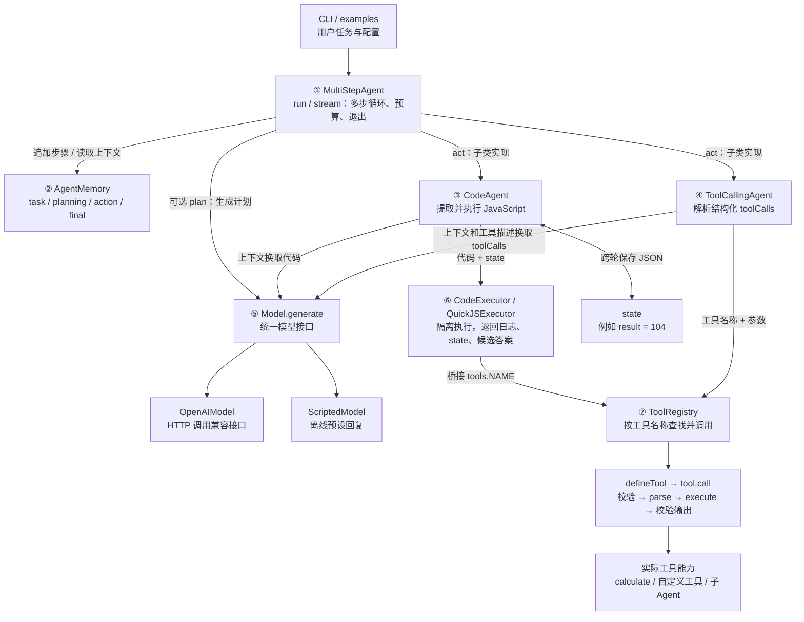
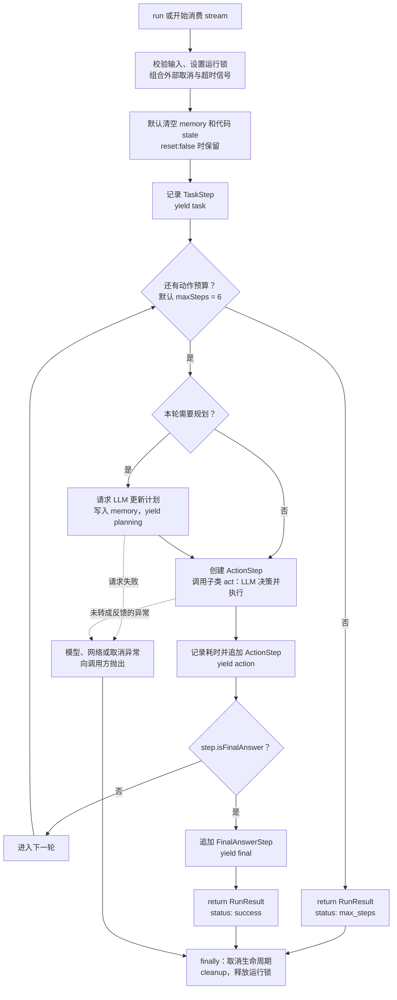

# 架构与关键取舍

## 架构总览

从上到下看：入口提交任务，共享循环负责调度，具体 Agent 决定动作形式，模型与执行器分别负责决策和执行。箭头标注调用或数据流；`CodeAgent` 与 `ToolCallingAgent` 都继承 `MultiStepAgent`。



| 标号            | 负责什么                                                                     | 阅读入口                                                  |
| --------------- | ---------------------------------------------------------------------------- | --------------------------------------------------------- |
| ① 共享循环     | 注册工具、初始化记忆；在运行时控制规划、动作轮数、步骤流和退出               | [multi-step-agent.ts](../src/agents/multi-step-agent.ts)     |
| ② 记忆         | 保存步骤快照；`toMessages()` 生成后续模型调用的上下文                      | [agent-memory.ts](../src/memory/agent-memory.ts)             |
| ③ 代码策略     | 每轮请求模型生成代码，解析唯一代码块，执行并反馈                             | [code-agent.ts](../src/agents/code-agent.ts)                 |
| ④ 工具调用策略 | 每轮请求模型生成结构化工具调用，按序执行并回传对应调用 ID                    | [tool-calling-agent.ts](../src/agents/tool-calling-agent.ts) |
| ⑤ 模型适配     | 将统一消息转为 HTTP 请求，再将响应转回文本、工具调用和 usage                 | [openai-model.ts](../src/models/openai-model.ts)             |
| ⑥ 代码执行器   | 新建 QuickJS 环境，注入 `state`、工具、日志和提交答案函数，执行后导出 JSON | [quickjs-executor.ts](../src/executors/quickjs-executor.ts)  |
| ⑦ 工具注册表   | `definitions()` 提供工具描述；`call()` 查找具体工具并进入业务逻辑        | [tool.ts](../src/tools/tool.ts)                              |

模型不访问工具实现；它只接收消息和工具描述。执行器不访问模型；它只接收代码、工具注册表、状态和取消信号。工具不需要知道调用方是哪一种 Agent。记忆不请求模型，也不执行工具。

这些边界使你可以独立替换模型服务、工具集合或执行环境，不需要修改共享循环。

## 一次任务的执行流程

构造 Agent 时创建工具注册表与记忆对象。开始消费 `stream(task)` 时才执行任务流程；`run(task)` 内部也会消费同一个生成器。



流程图展示正常消费步骤流及主要运行期异常。普通工具、代码和答案校验错误由 `act()` 转成反馈，仍经过保存动作和下一轮；模型请求错误或取消会向外抛出。动作异常上抛时，`finally` 仍保存该次动作，但不会执行后续的 `yield action`。消费者提前关闭生成器也会执行清理。

需要注意的调度细节：

- `planningInterval` 不配置就不独立规划；配置为 `N` 时，在第 `1、1+N、1+2N……` 轮动作之前生成计划。计划会追加到记忆，规划请求不单独计入 `maxSteps`。
- `act()` 每轮都会请求 LLM，即使刚刚已经做过规划。规划通过消息上下文影响后续决策。
- 一轮动作可以执行多个普通工具，但只在该轮结束后输出一个 `ActionStep`。
- `isFinalAnswer` 初始化为 `false`；子类在候选答案通过校验后修改同一个 `step` 对象，外层循环随后读取它。
- `yield` 返回本次步骤并暂停；调用方继续迭代后才执行后面的完成判断。最后 `return` 的是 `RunResult`，不是另一个 `MemoryStep`。
- `run()` 持续调用 `next()`，读到 `done:true` 时取回最终结果；普通 `for await...of` 只接收 `yield` 的步骤。

## CodeAgent：一次任务中的两轮动作

以“计算 `(6 + 7) × 8`，保存结果，再在下一步提交答案”为例：

| 阶段        | 本轮内容                                                                     | 保留或输出什么                                                                 |
| ----------- | ---------------------------------------------------------------------------- | ------------------------------------------------------------------------------ |
| 任务        | 记录用户输入                                                                 | memory 追加 task，输出 `TaskStep`                                            |
| 第 1 轮 LLM | 返回包含 `state.result = (6 + 7) * 8; console.log(state.result);` 的代码块 | 提取纯代码交给执行器                                                           |
| 第 1 轮执行 | QuickJS 计算并记录日志                                                       | `state.result` 导出为 `104`，日志成为模型可见观察，`isFinalAnswer:false` |
| 第 2 轮 LLM | 读取上轮消息与观察，返回包含 `final_answer(state.result);` 的代码块        | 再次提取本轮代码                                                               |
| 第 2 轮执行 | 新 QuickJS 环境恢复 `state.result = 104`，捕获答案提交                     | Agent 验收后设置 `step.output = 104`、`step.isFinalAnswer = true`          |
| 结束        | 共享循环判断完成                                                             | 输出 action、final，返回成功的 `RunResult`                                   |

### memory 与 state 的区别

| 对象                | 保存什么                                               | 谁使用                                               |
| ------------------- | ------------------------------------------------------ | ---------------------------------------------------- |
| `AgentMemory`     | 用户任务、计划、模型消息、执行观察、最终答案等步骤记录 | 调度层保存历史，模型通过 `toMessages()` 获取上下文 |
| `CodeAgent.state` | 代码显式写入的 JSON 值，如 `{ result: 104 }`         | 执行器跨动作恢复数据，供下一轮代码访问               |

模型不会直接读取执行器内存或 `state` 对象。它依据历史代码和反馈继续生成代码；执行器负责将实际 JSON 值传给下一轮。`const`、`let` 等局部变量属于当轮解释器，不会跨轮自动保留。

`CodeAgent` 中的 `final_answer(value)` 是执行器注入的独立函数，捕获答案并结束当前动作；`ToolCallingAgent` 则调用注册表里的 `final_answer` 工具。两种路径都需要通过 `checkAnswer()`，然后由共享循环记录 final 并结束任务。

## 为什么有一个基类、两个策略

Python 的 `agents.py` 把共享循环与具体策略放在同一个较大的文件里。这里保留职责明确的 `MultiStepAgent` 抽象基类，把两个具体策略拆成独立文件。

共享循环负责：

1. 创建运行生命周期并检查并发、取消、超时。
2. 清空或保留记忆，记录任务。
3. 按周期生成规划。
4. 在预算内调用子类的 `act()`。
5. 保存动作、输出步骤、判断是否完成。
6. 返回结构化结果并释放运行锁。

`ToolCallingAgent.act()` 将模型的 `toolCalls` 交给注册表，按调用 ID 把观察写回消息。`CodeAgent.act()` 提取代码块，交给执行器，再将日志或错误写回消息。两者都通过共享的 `checkAnswer()` 验收候选答案。

## 类型与运行时校验分开

TypeScript 类型在运行时会被擦除，外部模型生成的参数仍然可能错误。因此 `Tool` 同时具有 `parameters` 和 `call()`；`defineTool()` 的实际执行流程是：

```text
unknown → schema 校验 → parse 缩窄成 Input → execute → JSON 输出校验
```

`Schema` 支持空 schema、string/enum、number、integer、boolean、null、array/items、object/properties/required/additionalProperties。它是明确的子集；没有实现 `$ref`、组合 schema 或完整 JSON Schema。嵌套对象默认拒绝额外参数。

`parse` 是外部数据到内部类型的边界。计算器在校验后做简单类型断言，是因为其明确 schema 已校验相关字段；你自己的复杂工具可以在 `parse` 中构造领域对象。

跨模型、工具和执行器的值使用 `JsonValue`。Python 中图像、音频、可调用对象等动态值没有直接移植到这条数据边界。

## 记忆是一份事实源

`MemoryStep` 是带 `kind` 字段的联合类型。`AgentMemory` 保存步骤，`toMessages()` 再把它们投影成模型所需的消息。读取和追加都复制数据，避免示例或调用方意外修改已经保存的历史。

`run(task)` 默认清空记忆；`run(task, {reset: false})` 续接同一会话。返回结果只包含本轮新增步骤，`agent.memory.steps` 则包含完整会话。`CodeAgent` 在默认重置时也清空 `state`。

步骤流不等于 token 流。这里的 `stream()` 在任务、规划、动作和答案完成时产出，不实现服务端 SSE token 流。提前 `break` 会关闭生成器并释放运行锁；手动调用 `next()` 的使用者也应在放弃流时调用 `return()`。

## 错误与终止

| 情况                                   | 行为                                       |
| -------------------------------------- | ------------------------------------------ |
| 参数错误、未知工具、代码语法或执行错误 | 记录观察，消耗一个动作预算，允许下一步修正 |
| 最终答案校验不通过                     | 反馈给模型，继续执行                       |
| 模型网络错误或无效模型响应             | 直接抛出，交给应用处理                     |
| 外部取消、运行总超时                   | 中止等待并抛出原始原因                     |
| 预算耗尽                               | 返回 `max_steps`，不追加兜底模型调用     |
| 候选答案通过校验                       | 记录 final，返回 `success`               |

批次里的 `final_answer` 必须独立提交，避免其他工具在最终提交之后继续运行。一般工具按序调用；一个调用失败后，批次中的其他普通调用仍会执行，每个调用都得到对应的 tool response。

## QuickJS 的执行边界

执行器运行在独立 QuickJS/WASM 堆中，不向客体注入宿主对象、Node 模块、网络或文件系统。工具参数、工具结果和 `state` 通过 JSON 传输。工具本身在宿主环境运行，应只注册任务需要的能力。

每个动作新建解释器；成功动作导出的 `state` 传给下一步。失败动作不导出 state，但已经执行的宿主工具副作用不会回滚。最终答案被验收拒绝时，成功动作的 state 仍保留，方便下一步修正。

默认每步 2 秒、32 MiB WASM 内存、32 次工具调用，代码和数据的长度也有限制。WASM 内存通过 `WebAssembly.Memory.maximum` 限制；未依赖此版本 QuickJS 的内存统计来实现硬上限。

这是便于学习的进程内执行器：CPU 密集动作在中断前会占用 Node 主线程，取消信号要等事件循环恢复才能送达；因此 CPU 限时也检查绝对截止时间。高并发应用可实现 Worker 或远程 `CodeExecutor`。宿主工具应响应传入的 `signal`；仅停止等待无法撤销一个忽略取消的工具操作。

只支持提示词约定的同步动作，未实现客体 Promise 事件循环。模型应使用 `state` 保存 JSON 值，避免自行创建异步工作。框架本身和真实模型请求均使用异步 API。
